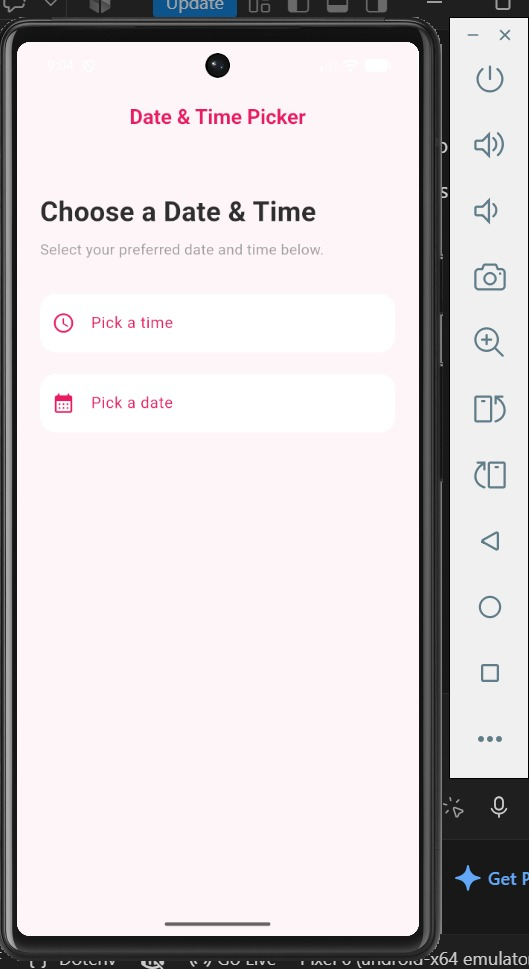
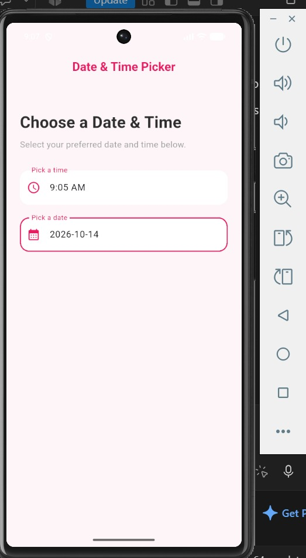
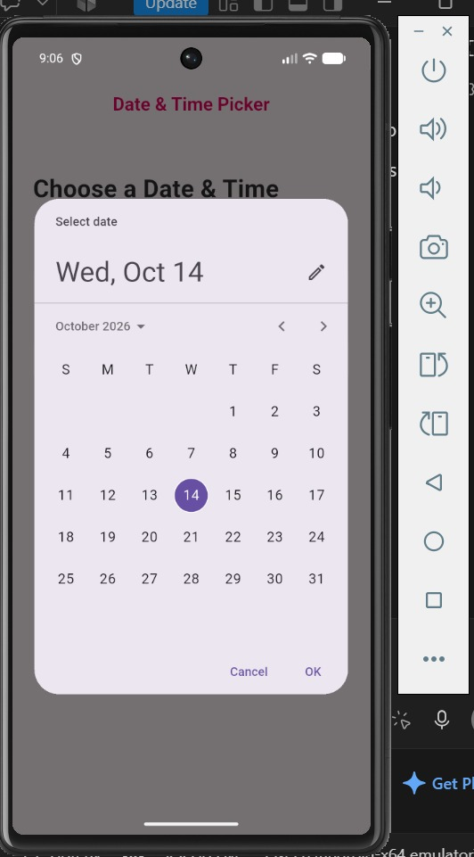
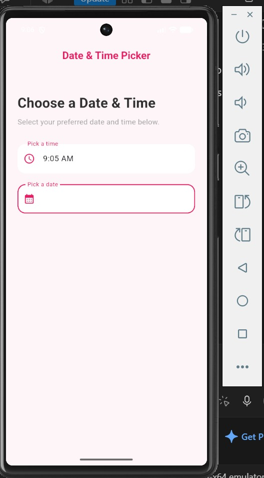
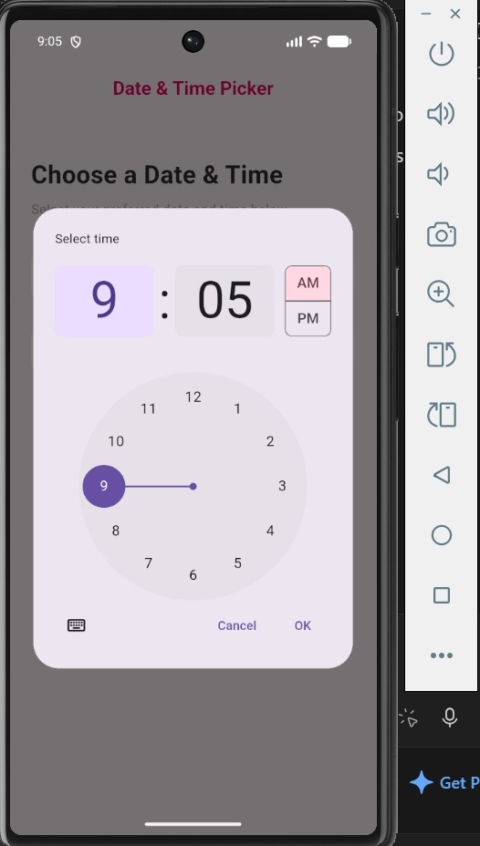

# Flutter Date & Time Picker

A simple Flutter screen with two tappable fields that open the Material date and time pickers and show what you chose.

## Screenshots

The screens in the order you see them when using the app.

| Home | Time picker | Time chosen | Date picker | Final UI |
| :---: | :---: | :---: | :---: | :---: |
|  |  |  |  |  |

## How to run

You need Flutter installed, plus an emulator or a connected phone.

```bash
git clone https://github.com/ishejaladouce/Flutter_date-time-picker.git
cd Flutter_date-time-picker/date_time_picker
flutter pub get
flutter run
```

## The three attributes

The date picker is built around three attributes:

- `initialDate`: the date the picker opens on. I set it to today.
- `firstDate`: the earliest date someone can pick. I set it to 1958.
- `lastDate`: the latest date someone can pick. I set it to 2100.

The time picker uses `initialTime`, which opens on the current time. The date is formatted as `yyyy-MM-dd` with the `intl` package.

## Project structure

```
lib/
  main.dart        app entry point
  pages/
    home.dart      the date and time picker screen
  screenshots/     images used in this README
```